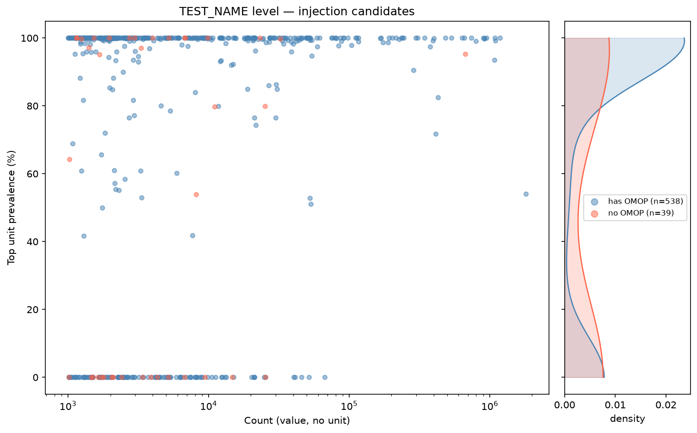

# Unit injection exploration

Site: https://finngen.github.io/kanta_lab_injection/

`data/injection_results.tsv` on `master` is the release consumed by
[kanta_lab_preprocessing](https://github.com/FINNGEN/kanta_lab_preprocessing)'s engine, which
fetches it at run time. The Usagi reference tables (`LABfi.tsv`,
`quantity_source_unit_conversion.tsv`) are refreshed from
[kanta_lab_harmonisation_public](https://github.com/FINNGEN/kanta_lab_harmonisation_public) on
load by `reference_data.py`, falling back to the snapshots in `reference/` when offline — the
same sources and mechanism the engine uses.

The goal is to identify lab measurements that have a numeric value but are missing a unit, and to characterise the unit distribution of the matching records that do have a unit — so that a unit can be confidently assigned to the missing ones.

## Summary



*Active threshold: 98% — min count: 500 — 715 TEST_NAMEs, 31,962,504 measurements*

| Threshold | UNAMBIGUOUS test names | UNAMBIGUOUS measurements | AMBIGUOUS test names | AMBIGUOUS measurements | NO_DATA test names | NO_DATA measurements |
| --- | ---: | ---: | ---: | ---: | ---: | ---: |
| 95% | 434 (60.7%) | 26,508,342 (82.9%) | 79 (11.0%) | 4,345,264 (13.6%) | 202 (28.3%) | 1,108,898 (3.5%) |
| 98% \* | 413 (57.8%) | 24,979,594 (78.2%) | 100 (14.0%) | 5,874,012 (18.4%) | 202 (28.3%) | 1,108,898 (3.5%) |
| 99% | 392 (54.8%) | 22,954,996 (71.8%) | 121 (16.9%) | 7,898,610 (24.7%) | 202 (28.3%) | 1,108,898 (3.5%) |
| 100% | 275 (38.5%) | 12,745,902 (39.9%) | 238 (33.3%) | 18,107,704 (56.7%) | 202 (28.3%) | 1,108,898 (3.5%) |
| **TOTAL** | **715** | | | || |

---

## Repository layout

| Folder | What it holds |
| --- | --- |
| `scripts/common/` | Shared code: the KS / T / MAD engine (`injection_engine.py`), what may be published (`disclosure.py`), `split_eval.py`, the Usagi reference tables (`reference_data.py`), reference-range logic (`ranges.py`), the ClickHouse helper (`clickhouse.py`) |
| `scripts/primary/` | Primary injection: `test_name_injection.py` (→ `data/injection_results.tsv`), its scatter plot, and `release_check.py` (checks the release files before they are published) |
| `scripts/unharmonized/` | Secondary injection: `suggest.py` (suggested fixes for rows that failed harmonization → `data/unharmonized/`), the older single-test `unharmonized_injection.py`, `omop_unit_table.py`, and `make_synthetic.py` for local tests |
| `scripts/site/` | The website: `build.py` builds everything, `primary.py` the injection results pages, `unharmonized.py` the suggestions portal |
| `scripts_ref/` | Reference-range experiments (not part of the release) |
| `data/` | Released files. `data/injection_results.tsv` is fetched by kanta_lab_preprocessing, so it stays at this path |

## Usage

```bash
python3 scripts/primary/test_name_injection.py [parquet_file] [options]
```

- `[parquet_file]`: the engine output parquet; default: the most recent run in `/mnt/disks/data/kanta/engine` (latest date in the folder name, as for the unharmonized suggestions)
- `--min-count INT`: minimum no-unit records a TEST_NAME must have to be included in plots and injection (default: 1000)
- `--prevalence-threshold FLOAT`: min dominant-unit prevalence (%) to classify a TEST_NAME as UNAMBIGUOUS (default: 98)
- `--min-target-n INT`: minimum reference records a unit must have; tests below this are classified NO_DATA (default: 30)
- `--min-subjects INT`: minimum people behind every group that is analysed or published: a TEST_NAME's no-unit rows, a reference unit, each side of a split, each listed unit (default: 5; see [What is published](#what-is-published-minimum-n))
- `--dump-dir PATH`: cache directory for the per-test value arrays (`.npz`, values with a person key each; default: `/mnt/disks/data/kanta/inject/tmp/`)
- `--omop-unit-table PATH`: cache path for the OMOP unit table; built automatically on first run (default: `omop_unit_table.tsv`)
- `--force`: recompute every test's result instead of reusing the cached ones (see below)
- `--plots`: also draw the private diagnostic PNGs into `--dump-dir` (comparison, bimodal and split figures; drawn from the raw values, never released, not used by the website). Off by default: they are slow
- `--inject`: run the injection engine (unambiguous + ambiguous + no_data passes)
- `--dip-threshold FLOAT`: Hartigan dip test p-value threshold for bimodality (default: 0.05)
- `--split-threshold FLOAT`: minimum relative KS improvement required to prefer a score-based split over the global fit (default: 0.15)
- `--test`: small-sample mode — one test per COUNT decile (unambiguous) and top 10 by volume (ambiguous)

### Caching behaviour

`test_name_counts.tsv`, `test_name_details.tsv` and `test_name_unit_summaries.tsv` are cached after the first ClickHouse query and reused on subsequent runs — delete them to force a re-query. They are always queried with a fixed baseline of `COUNT > 50`; `--min-count` is applied as a post-load filter in Python, so changing it never requires a re-query.

`plot_name_level.tsv`, `test_names_exploration_scatter.png`, and `summary_table.md` are always recomputed from the filtered data.

Per-test arrays are always cached in `--dump-dir` (`cand_{test}.npz`, `targ_{test}[_{unit}].npz`: the values and a person key per value, `cityHash64(FINNGENID)`) and reused across runs. The older value-only `.npy` caches are not read: they cannot count people.

Each test's result (its result rows and its plot-data entry) is cached in `<dump-dir>/results/<pass>_<test>.json` together with the key it was computed with: `CACHE_VERSION` (a constant in `test_name_injection.py`, bumped whenever the engine, the release rules or the result columns change), the release thresholds, the arguments and summary decisions that shape that test's result (unit list, `--min-subjects`, `--min-target-n`, `--dip-threshold`, `--split-threshold`), and size + modification time of its `.npz` arrays. A rerun reuses a result only when its saved key equals the current one, so changing an argument or re-querying a test's values recomputes it; the log ends each pass with `Result cache: N reused, M computed`. `--force` recomputes everything; `--plots` does too (the figures are drawn while computing). Only tests that ran to the end are cached. For a release, a run with `--force` guarantees nothing comes from older code.

`test_name_unit_summaries.tsv` holds rows and people per TEST_NAME × pre-injection unit (`NA` = no unit), counted on the same rows as the counts, the unit prevalence and the value arrays (`N_RECORDS`/`N_SUBJECTS`: rows with a value; `N_RECORDS_NUM`/`N_SUBJECTS_NUM`: rows with a numeric value). It contains small counts: it is a cache, never released.

---

## Step 1 — Injection targets (`test_name_counts.tsv`)

Counts records where at least one value is present (`MEASUREMENT_VALUE_EXTRACTED IS NOT NULL OR MEASUREMENT_VALUE_SOURCE IS NOT NULL`) but the unit prefix is absent (`MEASUREMENT_UNIT_PRE_FIX IS NULL`), grouped by `TEST_NAME`. Cached with `COUNT > 50`; further filtered to `--min-count` at runtime.

Columns: `TEST_NAME`, `COUNT`

---

## Step 2 — Reference population (`test_name_details.tsv`)

For every TEST_NAME in Step 1, describes the unit distribution of the records that already have both a value and a unit (`MEASUREMENT_VALUE_SOURCE IS NOT NULL AND MEASUREMENT_UNIT_PRE_FIX IS NOT NULL`).

Columns: `TEST_NAME`, `COUNT`, `UNIT`, `PREVALENCE_DICT`

- `COUNT`: total reference records for this TEST_NAME (across all units)
- `UNIT`: the most frequent unit
- `PREVALENCE_DICT`: top-3 units and their percentage share, e.g. `{mmol/l:98.5,umol/l:1.5}`

---

## Step 3 — Plotting table, scatter plot, and classification

Steps 1 and 2 are merged in Python to produce `plot_name_level.tsv`, a scatter plot, and a summary table. Each TEST_NAME is assigned a `CATEGORY` that drives which injection pass it enters.

### `plot_name_level.tsv`

One row per TEST_NAME. Columns include `COUNT`, `N_WITH_UNIT`, `top_prevalence`, `CATEGORY`, and exploratory `CATEGORY_{95,98,99,100}` columns.

- `COUNT`: no-unit record count
- `N_WITH_UNIT`: total reference records with any unit
- `top_prevalence`: prevalence (%) of the dominant unit; 0 if no reference records exist

### Classification (`CATEGORY`)

| Category | Condition |
|---|---|
| `NO_DATA` | `N_WITH_UNIT < --min-target-n` OR `top_prevalence == 0` OR the dominant unit's rows come from fewer than `--min-subjects` people |
| `UNAMBIGUOUS` | `top_prevalence >= --prevalence-threshold` |
| `AMBIGUOUS` | `0 < top_prevalence < --prevalence-threshold` |

The injection engine only runs tests classified as UNAMBIGUOUS or AMBIGUOUS. NO_DATA tests are written directly to `no_data_results.tsv`.

TEST_NAMEs whose no-unit rows come from fewer than `--min-subjects` people are dropped before this step: they are not classified, plotted, counted in the summary tables or injected.

### OMOP unit table (`omop_unit_table.tsv`)

Built once from the OMOP LAB mapping files and enriched with per-concept record counts queried from the parquet file. Cached at `--omop-unit-table`. Each OMOP concept is assigned a `CATEGORY`:

- `SINGLE` — only one unit observed in the OMOP data
- `EQUIVALENT` — multiple units present but all mutually convertible; a `CANONICAL_UNIT` is available
- `MULTIPLE` — multiple non-equivalent units; no single canonical unit can be assigned

This table is used to enrich `no_data_results.tsv` with canonical units.

Two summary tables are written:
- `summary_table.md` — all TEST_NAMEs
- `omop_summary_table.md` — OMOP-mapped subset only

---

## Step 4 — Injection engine (`--inject`)

With `--inject`, three passes are run and a coverage check validates that every TEST_NAME in `plot_name_level.tsv` appears in exactly one output file.

### Unambiguous pass → `unambiguous_results.tsv`

TEST_NAMEs with `CATEGORY == UNAMBIGUOUS`. The candidate distribution (no-unit records) is compared against the reference distribution for the dominant unit.

One row per TEST_NAME. Columns: `TEST_NAME`, `UNIT`, `PREVALENCE_DICT`, `N_CANDIDATE`, `N_TARGET`, `N_CANDIDATE_SUBJECTS`, `N_TARGET_SUBJECTS`, `CAND_DECILES`, `TARG_DECILES`, `KS_STAT`, `KS_MLOGP`, `KS_PASS`, `T_STAT`, `T_MLOGP`, `T_PASS`, `MAD_DIST`, `MAD_THRESHOLD`, `MAD_PASS`, `OUTCOME`, `NOTES`.

`N_*_SUBJECTS` are the people behind `N_CANDIDATE` / `N_TARGET`. The deciles are written only for groups large enough to show a distribution (see [What is published](#what-is-published-minimum-n)), `NA` otherwise.

### Ambiguous pass → `ambiguous_results.tsv`

TEST_NAMEs with `CATEGORY == AMBIGUOUS`. Only units with prevalence > 1%, at least `--min-target-n` reference records and at least `--min-subjects` people are considered.

Pipeline per TEST_NAME:

1. **Pre-check**: run the full (unsplit) candidate distribution against each qualifying unit.
2. **Bimodality check** (always runs, even if pre-check passed): test the candidate distribution for bimodality and compute `split_improvement` — the relative KS gain when the candidate is split at the GMM separator vs. treated globally.
3. **Split decision**: a split is preferred if `split_improvement > --split-threshold` AND the two halves favour different best units (`same_best_unit == False`). If splitting is not preferred and any pre-check passed, the global result is kept.
4. **Sub-distribution engine** (only if splitting is preferred): the candidate is split into low/high halves at the GMM separator and the engine is re-run on each half × unit. Both halves must come from at least `--min-subjects` people; otherwise the split is dropped, the global result is kept and `BIMODAL_STATUS` is `split_too_small` (a "mode" of a handful of people is not one, and its rows could be worked out as the total minus the other half).

One row per `(TEST_NAME, SUB_DIST)` — the best unit only. Best unit selection per sub-distribution:

1. Deciding test quality: `PASS_at_KS` > `PASS_at_T` > `PASS_at_MAD` > `FAIL`
2. `UNIT_PREVALENCE` descending as tiebreaker within the same quality tier — prefer the dominant unit when several pass the same test, since the KS statistic of a small target unit is noisy (e.g. u-ph: `form` 95% and `1` 3.5% both pass at KS; `form` is kept)
3. KS statistic ascending (lower = better distributional fit) as final tiebreaker

With `--plots`, a `split_eval_{tag}.png` decision-tree figure is saved to `--dump-dir` for every TEST_NAME.

Columns: `TEST_NAME`, `BIMODAL_STATUS`, `BIMODAL_SEP`, `BIMODAL_BC`, `BIMODAL_DIP_P`, `BIMODAL_OVERLAP`, `SCORE_GLOBAL`, `SCORE_SPLIT`, `SCORE_IMPROVEMENT`, `SUB_DIST`, `UNIT`, `UNIT_PREVALENCE`, `PREVALENCE_DICT`, `N_CANDIDATE`, `N_TARGET`, `N_CANDIDATE_SUBJECTS`, `N_TARGET_SUBJECTS`, `CAND_DECILES`, `TARG_DECILES`, `KS_STAT`, `KS_MLOGP`, `KS_PASS`, `T_STAT`, `T_MLOGP`, `T_PASS`, `MAD_DIST`, `MAD_THRESHOLD`, `MAD_PASS`, `OUTCOME`, `NOTES`.

- `SCORE_GLOBAL`: best KS statistic achieved across all units on the full candidate distribution (lower = better fit)
- `SCORE_SPLIT`: size-weighted mean of the best KS statistics for the low and high sub-distributions
- `SCORE_IMPROVEMENT`: `(SCORE_GLOBAL − SCORE_SPLIT) / SCORE_GLOBAL` — relative improvement from splitting
- `BIMODAL_OVERLAP`: GMM overlap coefficient expressed as a percentage. Computed as ∫ min(w₁·f₁(x), w₂·f₂(x)) dx × 100 on a fine grid covering ±4σ from each component mean, where f₁, f₂ are the Gaussian component densities and w₁, w₂ their mixture weights. A value of 0 % means the two modes are perfectly separated; values above ~5–15 % indicate meaningful overlap where values near the separator cannot be confidently assigned to either unit, with direct clinical implications (e.g. a low-mg value mislabelled as g would change the clinical interpretation by orders of magnitude). NA for unambiguous tests and for ambiguous tests where no split was performed.

### No-data pass → `no_data_results.tsv`

TEST_NAMEs with `CATEGORY == NO_DATA`. No engine is run. The result is enriched with OMOP unit table information; a canonical unit is injected where the OMOP concept has category SINGLE or EQUIVALENT.

Columns: `TEST_NAME`, `COUNT`, `OMOP_CONCEPT_ID`, `OMOP_QUANTITY`, `CATEGORY`, `N_UNITS`, `UNITS`, `CONVERSIONS`, `OMOP_TOTAL_N`, `UNIT`, `PREVALENCE`.

- `CATEGORY`: OMOP unit category (`SINGLE`, `EQUIVALENT`, `MULTIPLE`, or NA)
- `UNIT`: canonical unit from the OMOP table if available, otherwise blank
- `PREVALENCE`: fraction of OMOP concept records that are no-unit (`COUNT / OMOP_TOTAL_N`)

After writing, a breakdown is printed:
- no OMOP — TEST_NAMEs with no concept ID
- OMOP, unit injected — concept has SINGLE/EQUIVALENT category
- OMOP, no unit — concept mapped but MULTIPLE or unknown unit

### Unified output → `injection_results.tsv`

Merge of the unambiguous and ambiguous results with a `TYPE` column (`unambiguous` / `ambiguous`). Does not include no_data rows. This is the released file, so it is written in its publishable form:

- `PREVALENCE_DICT` (top 3) and `UNIT_PREVALENCE` are shares among the units used by at least `--min-subjects` people, not among all rows with a unit: rarer units are left out, so their rows cannot be worked back from the shares and `N_TARGET`. The classification itself still uses all rows.
- `N_CANDIDATE` / `N_TARGET` and their `_SUBJECTS` columns are `BELOW_THRESHOLD` for groups under `--min-subjects` people (the gates above make this rare).
- `BIMODAL_SEP` / `BIMODAL_OVERLAP` are left out (NA) on unsplit rows when a fitted component comes from too few people.

kanta_lab_preprocessing's engine reads only `TEST_NAME`, `SUB_DIST`, `CUTOFF`, `UNIT`, `OUTCOME`, `BIMODAL_BC` and `BIMODAL_OVERLAP`.

### Coverage check

After all three passes, a checksum validates that the union of the three output files equals the full set of TEST_NAMEs in `plot_name_level.tsv`, with no overlaps and no missing entries. Skipped in `--test` mode.

### Assignment summary

Printed at the end of `--inject`. Shows, for each category (UNAMBIGUOUS, AMBIGUOUS, NO_DATA) and in total, how many TEST_NAMEs and measurements received a unit (PASS rows), broken out for all TEST_NAMEs and the OMOP-mapped subset.

---

## Injection engine pipeline

Each comparison runs three tests in order. All three always run; the first to decide the outcome wins.

1. **KS test** — two-sample Kolmogorov–Smirnov. PASS = stat < 0.3 AND p < 0.05. Uses a fast binned approximation (100k bins, Hodges-corrected asymptotic p) above 500k samples; exact scipy otherwise.
2. **Welch t-test** — fallback if KS fails. PASS = p ≥ 0.05 (means not significantly different).
3. **MAD test** — last resort. PASS = |median(candidate) − median(target)| ≤ 3 × MAD(target).

Decision rule: KS PASS → PASS. KS FAIL, T PASS → PASS. Both fail → MAD decides. `NOTES` records the deciding test and how many of the three passed, e.g. `PASS_at_T_(2/3)`.

P-values are stored as −log10(p) throughout (`KS_MLOGP`, `T_MLOGP`).

With `--plots`, each comparison also produces a 3-panel diagnostic plot saved to `--dump-dir` (private: drawn from the raw values, never released):
- **Panel 1**: ECDFs + KS distance marked in red + KS annotation
- **Panel 2**: KDE (linear scale) + dotted mean lines + t-test annotation
- **Panel 3**: KDE (log scale) + MAD band (green = PASS, salmon = FAIL) + median lines + distance arrow

KDE/ECDF rendering downsamples to 50k points. All statistics use the full arrays. The website shows the same comparison from the published percentiles only (see below).

---

## Bimodal check

Before the ambiguous sub-distribution pass, the candidate distribution is tested for bimodality using two statistics:

The candidate array is subsampled to 50,000 points before the dip test and GMM fitting (the dip test is unreliable above ~72k samples and GMM fitting is also faster at this size). All statistics and the separator are computed on this subsample.

**Hartigan's dip test** (primary gate): p-value < `--dip-threshold` (default 0.05) declares non-unimodal.

**Bimodality coefficient** (BC): `(skew² + 1) / (excess_kurtosis + 3(n−1)²/((n−2)(n−3)))`. Values above ~0.555 suggest bimodality.

Both are computed in the space (linear or log) where a 2-component GMM achieves lower BIC. The GMM separator is used to split the candidate distribution.

| dip p | BC | Status |
|---|---|---|
| ≥ threshold | — | `unimodal` |
| < threshold | ≥ 0.555 | `bimodal` — split into low/high |
| < threshold | < 0.555 | `bimodal_cautious` — split, modes may overlap |
| — | — | `skipped` — pre-check passed and split not preferred |
| — | — | `split_too_small` — a split was called for, but one half comes from fewer than `--min-subjects` people |

`split_by_score` is a separate label assigned when score improvement alone drives the split (`SCORE_IMPROVEMENT > --split-threshold` and the two halves favour different best units) but the dip test did not find bimodality. When the dip test does confirm bimodality, the `bimodal` or `bimodal_cautious` label takes priority even if score improvement is also large — so `split_by_score` strictly means "split was justified by score despite a unimodal dip result."

The `NOTES` column in the unified output records the split rationale followed by `DIP` and `OL` metrics:
- `split_by_bimodal at Y | DIP:p,BL:x%` — dip-test-confirmed bimodal split at separator Y
- `split_by_bimodal_cautious at Y | DIP:p,BL:x%` — as above, with overlapping modes
- `split_by_score (+X%) at Y | DIP:p,BL:x%` — score-driven split despite unimodal dip result
- `NO_SPLIT` — no split performed (pre-check passed, or unimodal with no score preference)

`DIP` is the Hartigan dip test p-value; `BL` is the bimodal overlap percentage (see `BIMODAL_OVERLAP` above).

`BIMODAL_OVERLAP` (see above) quantifies how cleanly separated the two modes are after any split. With `--plots`, a diagnostic plot (`bimodal_{tag}.png`) is saved to `--dump-dir`.

---

## What is published (minimum N)

The release (`data/injection_results.tsv`, `data/plot_data.json.gz`, the summary tables and the scatter plot) and the website built from it follow FinnGen's rule for exported results: every group they describe comes from at least 5 people (`--min-subjects`). Rows are not people (one person can have hundreds of INR rows), so people are counted throughout: in `test_name_unit_summaries.tsv` for the TEST_NAMEs and units, and from the person key of every value for the compared groups and the split halves. The rules live in `scripts/common/disclosure.py`.

- **Groups.** A TEST_NAME's no-unit rows, a reference unit and each half of a split need at least 5 people to be analysed at all (see above). Rows and people of a compared group are published (`N_*`, `N_*_SUBJECTS`).
- **Units.** Unit shares are among the units used by at least 5 people (see the unified output).
- **Distributions** are published only as percentiles P5, P10, … P95 (and the mean), never as raw curves, histograms, minimum or maximum. A side gets percentiles only when it has at least 60 people (the decile rule of kanta_lab_preprocessing's summaries: people // 10 > 5) and 100 rows (P5 and P95 then lie beyond the 5 most extreme rows), and when every 5% stretch of its rows between two percentiles, and each tail beyond P5 / P95, comes from at least 5 different people: read as bars of equal mass, that is the histogram rule (each bar from at least 5 people), and it keeps one heavy tester from owning a percentile. Otherwise the side shows only its rows, people and mean.
- **Tests** (KS, Welch t, MAD with its medians) are single statistics of groups of at least 5 people and are published as they are.
- **Bimodal fits** are published as parameters (mean, sigma, weight of each component), and only when each component — every row assigned to its most likely component — comes from at least 5 people; otherwise neither the components nor the separator and overlap are shown.

The test pages draw, per comparison: the candidate and target percentiles; their distributions as overlaid bars between neighbouring percentiles (each bar holds 5% of the rows, so its height is 5% / width; in log10 space when all values are positive) with a smooth line through them (each bar spread as a normal curve of half its width, at least 1/25 of the range), both built from the percentiles alone; and a P5–P25–median–P75–P95 box per side with the mean and the MAD band. The bimodal section draws the fitted components over the candidate's percentiles as bars of equal mass (5% of the rows each).

`scripts/primary/release_check.py [DATA_DIR]` checks the release files for anything that breaks these rules (counts under the minimum, percentiles of small groups, row-level keys or unknown fields in the plot data). `--release` runs it on the new files and copies nothing when it finds a problem.

---

## Unharmonized suggestions

Rows with a numeric value but no harmonized value are grouped by test × unit. `scripts/unharmonized/suggest.py`
works out each group's OMOP concept and candidate units, then weighs two independent kinds of evidence:

- **Values**: the engine's KS / T / MAD tests on the group's values against the concept's harmonized values, converted
  to each candidate unit.
- **Reference ranges**: the group's lower / upper limits, multiplied by each candidate's factor, against the concept's
  typical ranges (learned from the rows already harmonized). A concept can have more than one typical range, e.g. INR's
  normal range and the warfarin target.

Each group gets a **result**:

- **Suggest fix**:
  - high confidence: values (KS or T) and ranges agree;
  - medium: only one kind of evidence, or values pass only the MAD test.
- **Unit is right: approve the Usagi row**: the best fit is the group's own unit (same confidence levels). Nothing
  changes in `omop_injection.tsv`: the rows fail only because the `(test, unit)` row in Usagi is unchecked or
  missing, and approving it (`NEEDS`) lets them harmonize with the existing conversion.
- **Review: values and ranges disagree**
- **Review: needs a split**: the ranges point to two units.
- **No unit fits**: none of the concept's units (the units the conversion table converts into its unit) passes. The
  reason gives the closest value fit and range match, and how far off the ranges are.
- **Not decidable**, when there is nothing to compare against: *test not in Usagi*, *test only unchecked in Usagi* (with the proposed concept when an
  unchecked row has one), *too few harmonized rows*,
  or *no conversion into the concept's unit*. The reason says exactly what is missing.

Only rows with a numeric value are counted. Each group's list is decided first, from the cached data alone: no
concept, too few harmonized rows or no conversion makes it *not decidable*. Each list has its own minimum size:
`--min-count` (default 1000 failed rows) for decidable groups, `--min-count-undecidable` (default 1000) for the rest;
1000 matches the primary injection's threshold, so smaller groups are left to it.
Both lists are on the portal.

The page also shows the concept case:

- Mapped in Usagi, conversion failed
- Pair waiting for Usagi review
- Concept taken from the test's other units
- Test maps to several concepts
- No concept in Usagi

And the unit problem:

- Unit missing
- Unit is a synonym or incomplete
- Unit does not match the values
- Conversion missing from the table
- Only a formula conversion exists
- Too few harmonized rows to compare

```bash
# on the data VM; default input = the latest run in /mnt/disks/data/kanta/engine
python3 scripts/unharmonized/suggest.py --out-dir OUT            # add --release to copy into data/unharmonized/
python3 scripts/unharmonized/suggest.py --out-dir OUT --test b-hkr
```

The engine parquet is read in four full scans: one dumps every row that failed harmonization to
`<dump-dir>/<input name>/failed.parquet`, and three fetch the harmonized side of the concepts involved. Everything else
runs from that cache, so re-runs with other thresholds take seconds; a lower `--min-count` only fetches the concepts
not seen before. The cache is rebuilt when the input file changes (another name, or the same name
with a different size or time), or with `--force`.

Outputs:

- `decidable.tsv`: the decidable groups, with result and reason.
- `not_decidable.tsv`: the not-decidable groups, with reason and what each needs.
- `groups.tsv`: both lists together (used for the portal).
- `candidates.tsv`: the evidence per candidate unit.
- `proposed_omop_injection.tsv`: the suggested fixes in `omop_injection.tsv` format, compared with the current rules.
- `summary.md`
- `plot_data.json.gz`: aggregates only. Counts under 5 are hidden, a concept's harmonized-row count is only given from 100 up (the minimum to compare against), and reference texts are never read.

**Terms.** On the portal and in the issues, *unharmonized rows* are the rows of one test × unit that fail
harmonization (the rows a fix is for), and *candidate units* are the units tested as that fix. ("Candidate" is not used
for the rows here, unlike in the primary injection.)

**Portal and review.** `python3 scripts/site/build.py` builds the injection pages and, when `data/unharmonized/` exists,
the portal under `unharmonized/`. Each group page has an *Open review issue* button. It opens a GitHub issue in
[kanta_lab_harmonisation_public](https://github.com/FINNGEN/kanta_lab_harmonisation_public/issues) titled
`[unharm] <test> · <unit>`, with a link back to the page, the evidence figure, the candidate table and the unit
history.

- **Figures (decidable groups only):** `suggest.py` draws them into `data/unharmonized/figures/<suggestion id>.png`. Each is drawn once,
  when the suggestion first appears, and is never replaced, so an issue keeps the evidence it was opened with.
- **Issue status on the portal:**
  - issues are looked up by title when the site is built;
  - a closed issue whose rows still fail, or whose suggestion has changed since, is flagged on the page;
  - issues whose group has left the data are listed in the *Resolved* tab.

**Local test with synthetic data:**

```bash
python3 scripts/unharmonized/make_synthetic.py --out /mnt/disks/data/kanta/tmp/unharm
python3 scripts/unharmonized/suggest.py --input /mnt/disks/data/kanta/tmp/unharm/synthetic_engine.parquet --out-dir /mnt/disks/data/kanta/tmp/unharm/out \
    --dump-dir /mnt/disks/data/kanta/tmp/unharm/dump --injection-table /mnt/disks/data/kanta/tmp/unharm/omop_injection.tsv
python3 scripts/site/build.py --unharmonized-dir /mnt/disks/data/kanta/tmp/unharm/out --out-dir /mnt/disks/data/kanta/tmp/unharm/site --no-github
```
